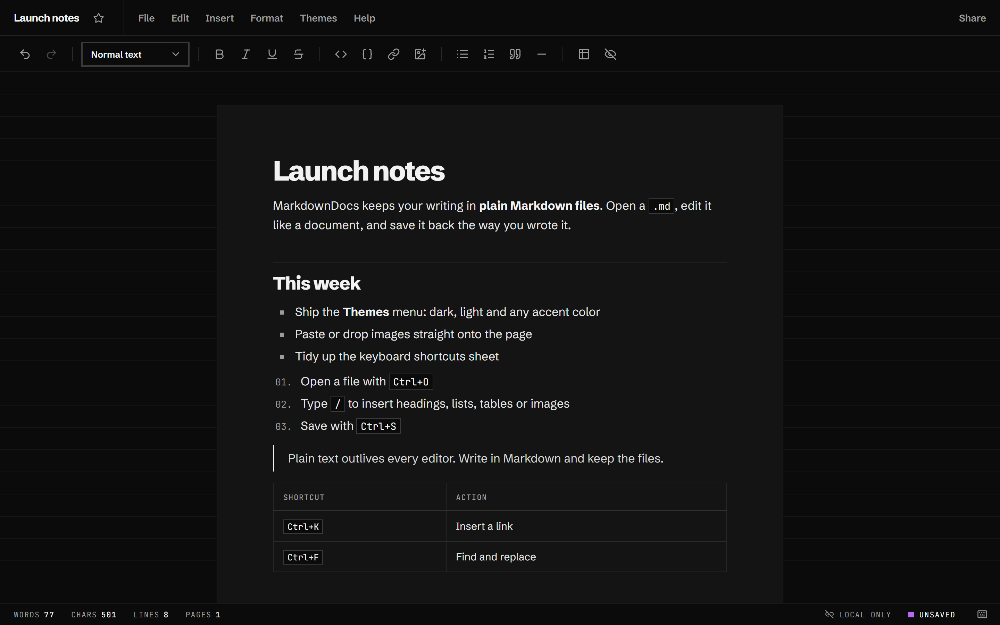
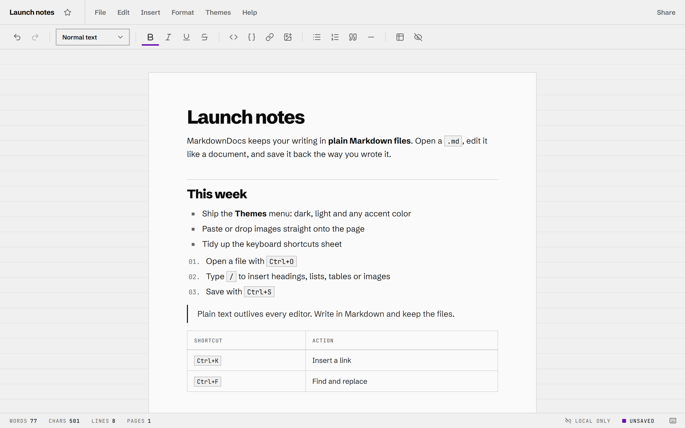
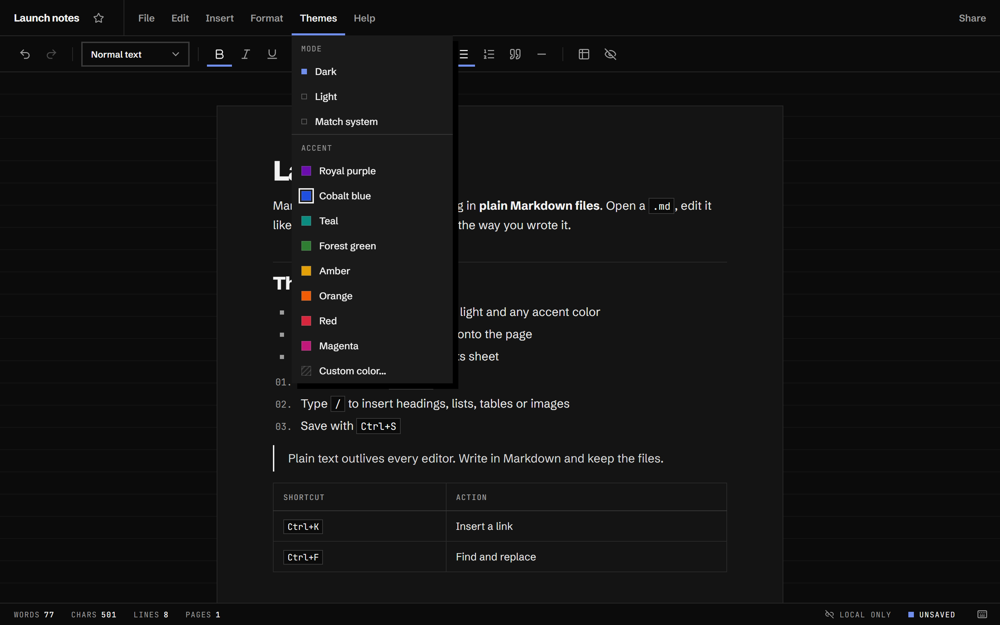
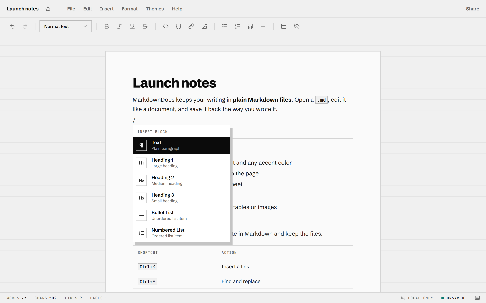
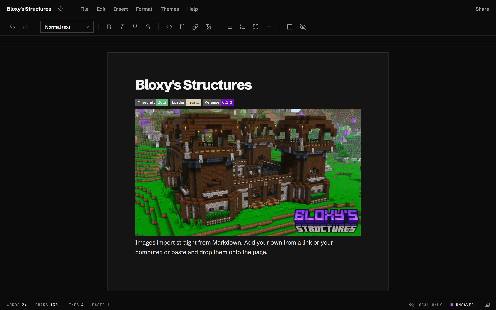

<div align="center">


# MarkdownDocs

**Google Docs, but for Markdown and open-source.**

Edit `.md` files like documents. Save them back as clean, plain Markdown.

[](https://github.com/ItzBloxy/MarkdownDocs/releases/latest)
[](#download)
[](LICENSE)
[](https://tauri.app)

[**Download for Windows**](https://github.com/ItzBloxy/MarkdownDocs/releases/latest) &nbsp;&nbsp; [Features](#features) &nbsp;&nbsp; [Shortcuts](#keyboard-shortcuts) &nbsp;&nbsp; [Build from source](#build-from-source)

<br>



</div>

<br>

## Why MarkdownDocs

Markdown is the right format for notes, docs and READMEs: it's plain text, it diffs well and every tool can read it. Writing it in a code editor is less pleasant. MarkdownDocs gives you a page, a toolbar and the shortcuts you know from a word processor, while the file on disk stays ordinary Markdown that opens anywhere.

- **Your files stay yours.** Open a `.md` from disk, edit it, save it back in place. No account, no cloud, no proprietary format.
- **The Markdown stays tidy.** Saving writes clean Markdown and keeps your original line wrapping, so diffs stay small and readable.
- **It gets out of the way.** A calm, high-contrast interface, a resizable page, and an editor that turns Markdown syntax into formatting as you type.

## Download

Grab the latest build from the **[Releases page](https://github.com/ItzBloxy/MarkdownDocs/releases/latest)**.

| File | Use it when |
| --- | --- |
| `MarkdownDocs_<version>_x64-setup.exe` | You want the normal install. Adds a Start menu entry and **Open with** support for `.md`, `.markdown` and `.txt`. |
| `MarkdownDocs_<version>_x64_en-US.msi` | You deploy software with an MSI (for example, through IT tooling). |
| `MarkdownDocs_<version>_x64_portable.exe` | You want a single file to run without installing anything. |

**Requirements:** 64-bit Windows 10 or 11 with the Microsoft Edge WebView2 Runtime, which ships with Windows 11 and current Windows 10.

> [!NOTE]
> The builds aren't code-signed yet, so Windows SmartScreen may warn you the first time. Choose **More info**, then **Run anyway**. Each release lists SHA-256 checksums in `SHA256SUMS.txt` if you want to verify your download.

macOS and Linux builds aren't published yet. MarkdownDocs is built on [Tauri](https://tauri.app), which supports both, so you can [build from source](#build-from-source) on those platforms.

## Features

### Writing

- **Formatting as you type.** `# ` makes a heading, `- ` and `1. ` start lists, `**bold**`, `*italic*`, `[text](url)` and `` convert the moment you close them, and `---` draws a divider.
- **Slash commands.** Type `/` on an empty line to insert a heading, list, quote, code block, table, image or divider.
- **A real toolbar** with undo and redo, text styles, inline formatting, code, links, images, lists, quotes, tables and spoilers. Hover a button to see its name and shortcut.
- **Tables** with a header row. Right-click a cell to add or remove rows and columns.
- **Images** from a web address, or upload, paste and drop them straight onto the page. README badges like `[](…)` keep their links. Images that fail to load show a placeholder with their description instead of a broken icon.
- **Code blocks** keep their language (` ```ts `), and you can change it from the right-click menu.
- **Find and replace** across the document (`Ctrl+F`).
- **Context-aware right-click menu** for formatting, turning blocks into other blocks, links, code and tables.

### Files

- **Edits files in place**: open, save and save as, on the desktop app and in Chromium-based browsers.
- **Notices outside changes.** If another program changes the open file, MarkdownDocs reloads it. If you also have unsaved edits, it asks whether to reload from disk or keep your changes.
- **Never loses work quietly.** It warns before closing with unsaved changes, and **File → Revert to saved** discards edits on purpose.
- **Share** copies the whole document to your clipboard as Markdown.
- **Download a copy** or **Download as .md** when you just need the file.

### Make it yours

- **Themes:** dark, light, or match your system setting.
- **Any accent color.** Pick one of eight presets or choose your own. MarkdownDocs derives readable variants so lines and labels stay legible in both modes.
- **Resizable page.** Drag either edge of the page to change its width. Double-click an edge to reset it.
- **Works offline.** The fonts ship with the app; nothing loads from the internet unless your document links to it.

## Screenshots

<table>
  <tr>
    <td width="50%"></td>
    <td width="50%"></td>
  </tr>
  <tr>
    <td align="center"><sub>Light mode</sub></td>
    <td align="center"><sub>Themes: mode and accent color</sub></td>
  </tr>
  <tr>
    <td width="50%"></td>
    <td width="50%"></td>
  </tr>
  <tr>
    <td align="center"><sub>Slash commands</sub></td>
    <td align="center"><sub>Images and badges</sub></td>
  </tr>
</table>

## Keyboard shortcuts

On macOS, use <kbd>Cmd</kbd> wherever you see <kbd>Ctrl</kbd>. The full list is under **Help → Keyboard Shortcuts** in the app.

| Action | Shortcut | | Action | Shortcut |
| --- | --- | --- | --- | --- |
| Bold | <kbd>Ctrl</kbd> <kbd>B</kbd> | | New document | <kbd>Ctrl</kbd> <kbd>N</kbd> |
| Italic | <kbd>Ctrl</kbd> <kbd>I</kbd> | | Open | <kbd>Ctrl</kbd> <kbd>O</kbd> |
| Underline | <kbd>Ctrl</kbd> <kbd>U</kbd> | | Save | <kbd>Ctrl</kbd> <kbd>S</kbd> |
| Strikethrough | <kbd>Ctrl</kbd> <kbd>Shift</kbd> <kbd>X</kbd> | | Save as | <kbd>Ctrl</kbd> <kbd>Shift</kbd> <kbd>S</kbd> |
| Inline code | <kbd>Ctrl</kbd> <kbd>E</kbd> | | Revert to saved | <kbd>Ctrl</kbd> <kbd>Shift</kbd> <kbd>R</kbd> |
| Insert link | <kbd>Ctrl</kbd> <kbd>K</kbd> | | Find and replace | <kbd>Ctrl</kbd> <kbd>F</kbd> |
| Numbered list | <kbd>Ctrl</kbd> <kbd>Shift</kbd> <kbd>7</kbd> | | Undo | <kbd>Ctrl</kbd> <kbd>Z</kbd> |
| Bullet list | <kbd>Ctrl</kbd> <kbd>Shift</kbd> <kbd>8</kbd> | | Redo | <kbd>Ctrl</kbd> <kbd>Shift</kbd> <kbd>Z</kbd> |
| Blockquote | <kbd>Ctrl</kbd> <kbd>Shift</kbd> <kbd>9</kbd> | | Line break | <kbd>Shift</kbd> <kbd>Enter</kbd> |
| Indent / outdent list | <kbd>Tab</kbd> / <kbd>Shift</kbd> <kbd>Tab</kbd> | | Insert a block | <kbd>/</kbd> |

## Markdown support

MarkdownDocs reads and writes these:

| You write | You get |
| --- | --- |
| `# Heading` to `### Heading` | Headings, levels 1 to 3 |
| `**bold**`, `*italic*`, `***both***` | Bold and italic |
| `~~struck~~` | Strikethrough |
| `` `code` `` and fenced ` ``` ` blocks (with a language) | Inline code and code blocks; 4-space indented code imports too |
| `- item`, `1. item`, nested by indenting | Bullet and numbered lists |
| `> quote` | Blockquotes |
| `[text](https://…)` | Links |
| `` | Images, including `[](…)` linked badges |
| GitHub-style pipe tables | Tables with a header row |
| `---` | Horizontal rule |
| `__text__` | Underline *(MarkdownDocs extension)* |
| `\|\|text\|\|` | Spoiler that stays hidden until clicked *(MarkdownDocs extension)* |

Soft-wrapped paragraphs keep their line breaks when you save. Saving does normalize a few things, for example `*` bullets are written as `-` and table columns are padded to line up.

Not supported yet: headings 4 to 6, task lists, footnotes and raw HTML. They open as plain text, so nothing is lost, but they aren't formatted.

## Build from source

You'll need:

- [Node.js](https://nodejs.org) 20.19 or later (or 22.12+)
- For the desktop app: [Rust](https://www.rust-lang.org/tools/install) 1.77.2 or later and the [Tauri prerequisites](https://tauri.app/start/prerequisites/) for your OS

```bash
git clone https://github.com/ItzBloxy/MarkdownDocs.git
cd MarkdownDocs
npm install
```

| Command | What it does |
| --- | --- |
| `npm run dev` | Runs the web app at <http://localhost:5173>. Use Chrome or Edge for in-place saving; other browsers fall back to opening and downloading files. |
| `npm run app:dev` | Runs the desktop app with hot reload. It starts the dev server itself. |
| `npm run app:build` | Builds the desktop app and its installers into `src-tauri/target/release/bundle/`. |
| `npm run lint` | Lints the project with ESLint. |

## How it's built

- **Editor:** [Tiptap 3](https://tiptap.dev) on ProseMirror, with custom extensions for spoilers, images, slash commands, find and replace, and Markdown-style typing.
- **App:** React 19 and TypeScript, bundled with Vite.
- **Desktop:** [Tauri 2](https://tauri.app), which uses the system WebView for a small download.
- **Markdown:** a purpose-built importer and exporter (`src/utils/markdownImport.ts`, `markdownExport.ts`) that round-trips files without reflowing them.
- **Design:** "Raster", a strict-grid design system with zero-radius controls, hairline rules and a single accent color. Its reference kit lives in [`docs/style-reference`](docs/style-reference).

New to the codebase? [`CLAUDE.md`](CLAUDE.md) walks through the architecture, the file I/O modes and the theming tokens.

## Contributing

Bug reports and ideas are welcome in [Issues](https://github.com/ItzBloxy/MarkdownDocs/issues). For pull requests, open an issue first for anything larger than a small fix, keep changes focused, and run `npm run lint` before you push.

## License

[MIT](LICENSE) © 2026 ItzBloxy
